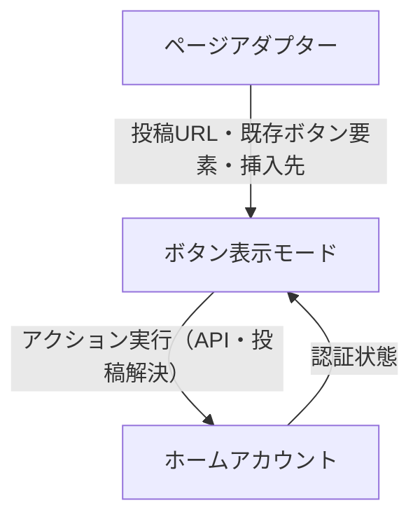

# モジュール設計

> 本書は v1 策定時点のスナップショットであり、実装に追従して更新はしない。現在の構成はコードを参照。

## 抽象化一覧

### 1. ホームアカウント

**責務**: ホームインスタンスへの認証・APIアクション実行・投稿解決

- OAuthフロー管理・認証状態の保持
- 複数アカウントの管理とアクティブアカウントの選択
- ホームインスタンスへのAPIリクエスト実行（お気に入り・ブースト・ブックマーク・返信）
- リモート投稿URLをホームインスタンス上で検索・取得する（「ホームインスタンスで開く」アクション用）

ホームインスタンスのソフトウェア（Mastodon・将来的にMisskey等）ごとに実装を定義する。

---

### 2. ページアダプター

**責務**: 現在のページからの投稿情報抽出と既存ボタン要素の提供

- 現在のページが対応クライアントかどうかの判定
- ページ内の投稿一覧の抽出
- 各投稿に対して以下を提供:
  - 投稿URL
  - 既存のアクションボタン要素
  - ボタンの挿入先要素

対象サイトのWebクライアント（Mastodon公式UI・Elk・Semaphore等）ごとに実装を定義する。

---

### 3. ボタン表示モード

**責務**: アクションボタンの描画方法の切り替え

ページアダプターから受け取った既存ボタン要素と挿入先をもとに、アクションボタンを表示する。以下の3モードを提供する:

| モード | 動作 |
|--------|------|
| 置換   | 既存のアクションボタンを拡張のボタンで置き換える |
| 追加   | 既存のアクションボタンの横に追加する |
| ポップアップ | ポップアップメニューとして表示する |

ユーザー設定によって切り替え可能。ホームアカウントが未認証の場合はボタンを表示しない。

---

## モジュール間の関係



### アクション実行フロー

```
ユーザーがアクションボタンをクリック
    │
    ├─ お気に入り・ブースト・ブックマーク・返信
    │       └─→ ホームアカウント（API実行）
    │
    └─ ホームインスタンスで開く
            └─→ ホームアカウント（投稿を検索・取得してURLを解決 → 遷移）
```

### 実装バリエーション

各抽象化がどの軸で変動するかを示す。

| 抽象化 | 変動軸 | 実装例 |
|--------|--------|--------|
| ホームアカウント | ホームインスタンスのソフトウェア | Mastodon実装・Misskey実装（将来） |
| ページアダプター | 対象サイトのWebクライアント | Mastodon公式UI・Elk・Semaphore |
| ボタン表示モード | ユーザー設定 | 置換・追加・ポップアップ |

---

## デバッグ用モック実装

実際のサーバーやMastodonページを用意せずに動作確認できるよう、各抽象化にモック実装を用意する。

### ホームアカウント（モック）

実際のHTTPリクエストを送らず、アクションの入力と結果をコンソールに記録する。

- **認証状態**: 設定で「認証済み」「未認証」「エラー」を切り替え可能。デフォルトは認証済み
- **アクション実行**: リクエストを送らず `[mock] action: <アクション名>, postUrl: <URL>` をコンソールに出力して成功を返す。設定で失敗を返すことも可能
- **投稿解決**: リクエストを送らず、渡された投稿URLをそのまま返す

### ページアダプター（モック）

任意のページで動作させるため、ページ判定を常にtrueとし、ダミー投稿データを生成する。

- **ページ判定**: 常に`true`を返す（どのURLでも動作する）
- **投稿抽出**: ページ内の`<article>`要素を投稿として扱い、以下のダミーデータを付与する
  - 投稿URL: `https://mock.example/users/mock_user/statuses/<連番>`
  - 既存ボタン要素: 空の配列（元ボタンなし扱い）
  - 挿入先: `<article>`要素自体

### ボタン表示モード（モック）

DOMを変更せず、表示すべき内容をコンソールに記録する。

- 各投稿に対して `[mock] render buttons: postUrl=<URL>, mode=<モード名>` をコンソールに出力する
- 実際のボタン要素は生成しない
